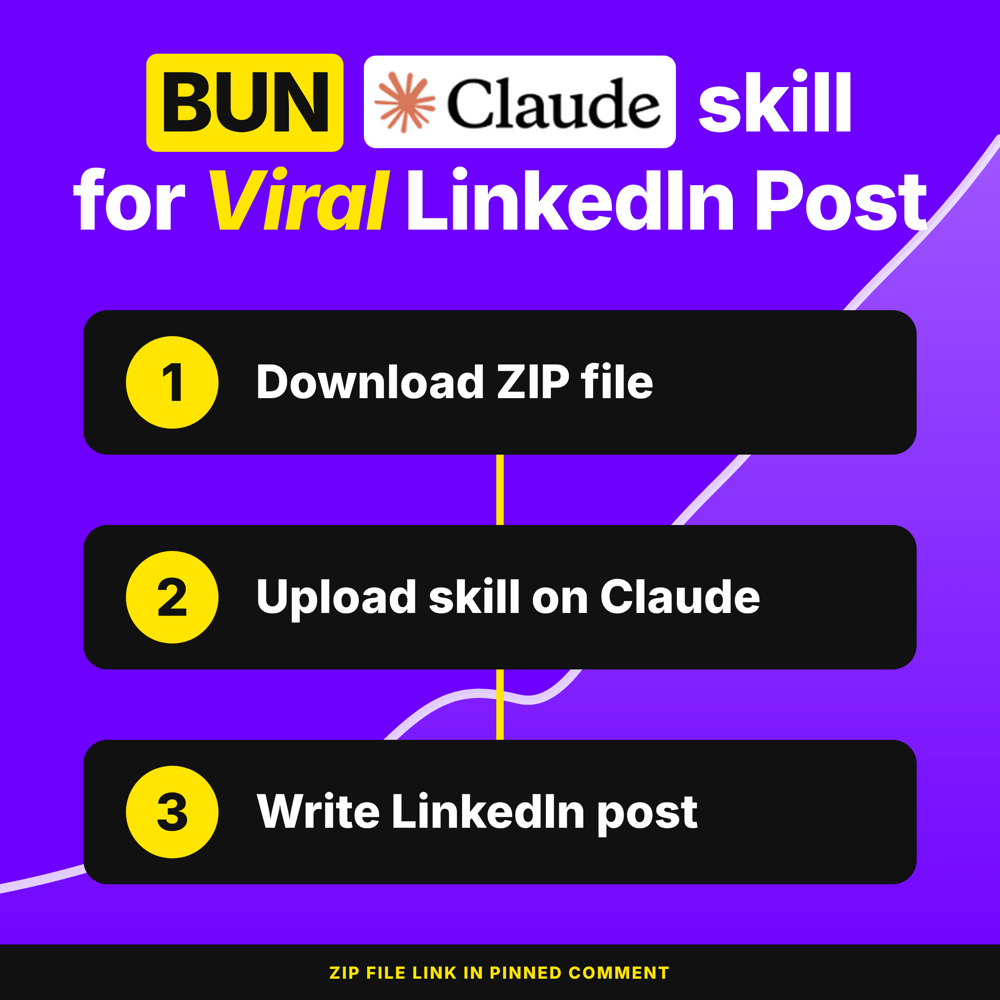
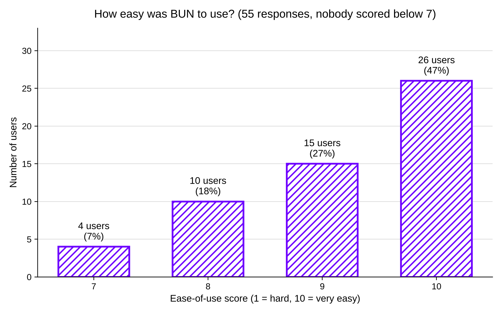
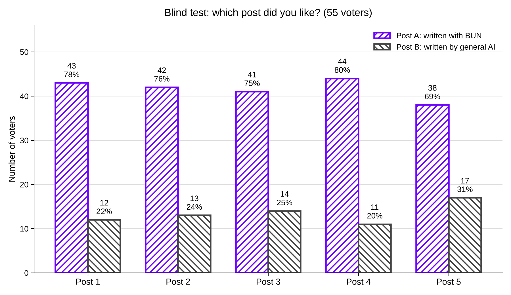

<p align="center">
  
</p>

# BUN: LinkedIn Post Writer for Claude

<p align="center">
  
  
  
  
  
  
</p>

**A Claude skill for LinkedIn.** BUN writes one publish-ready LinkedIn post at a time. It finds the idea, writes the hook, writes the body, and removes AI tells. It uses only the facts you give. No coding required.

## Real world usefulness and problem solving

**Volume wins.** Creators say it.

- Gary Vaynerchuk tells creators to post "6-7 meaningful pieces of content a day" on short-form stories. Source: his piece [Document, Don't Create](https://www.commpro.biz/news/gary-vaynerchuk-on-document-dont-create-creating-content-that-builds-your-personal-brand).
- Big LinkedIn creators post often. Average posts per week over two years, per MagicPost (a tool vendor, updated May 2026):

| Creator | Posts per week |
|---|---|
| Gary Vaynerchuk | about 20 |
| Justin Welsh | about 12 |
| Eric Partaker | about 9 |
| Chris Donnelly | about 8 |
| Matt Gray | about 7 |

**The problem.** A good post takes time. Many posts take more.

No public survey times one LinkedIn post. Closest numbers:

- HubSpot, State of Inbound 2015 (about 4,000 marketers): most spend 1-2 hours on a 500-word blog post. 29% of North American marketers spend 4+ hours.
- Sprout Social (500+ US and UK social marketers): full-time social marketers average 5 hours a week on content creation and approvals.
- One creator, Nils Liedlich, reports about 13 minutes per post, but only after building a system.

Weak hook = post ignored. So time goes into hooks, rewrites, and cutting robot wording. Volume and quality fight each other.

**The fix: BUN.** One broad skill. It writes LinkedIn posts built for more impressions, more reach, and more interaction. It keeps in mind how LinkedIn's feed ranks posts: stories that hold readers longer, no outside links in the body. Its patterns come from an analysis of 1,000 LinkedIn posts by top creators.

Note: advice on LinkedIn's ranking comes from creators and tools, not from LinkedIn.

## Usability

How easy was BUN to use? Users scored 1-10.

<p align="center">
  
</p>

- 55 users answered.
- 26 gave a 10. 15 gave a 9. 10 gave an 8. 4 gave a 7.
- Nobody scored below 7.
- Average: 9.15.
- 51 of 55 (93%) gave 8 or more.

Source: BUN feedback form, 26 Oct 2026. Self-reported.

## User feedback

Top 5 themes from the form. A user can fall in more than one theme. Not counted: answers about Claude in general, blanks, and one-word praise.

| # | What users said | Users | How BUN answers it | Status |
|---|---|---|---|---|
| 1 | Hook is weak or not engaging | 9 | 12 hook types, 103 templates. Hooks fit your post goal. Material test forces a real moment or number in the hook. 3 hooks to pick from | In BUN. Still improving |
| 2 | Tell it like a story | 5 | Story mode builds the idea from your own moment (28 idea shapes). Story hook type has 9 templates | Partly. Story body shape is next |
| 3 | Sounds robotic | 4 | Humanizer removes 17 core AI tells, plus share-post tells and invented stakes. 3rd grade words. Banned buzzwords | In BUN |
| 4 | Hashtags and numbered lists feel stiff | 2 | No hashtags. Bullets, never numbers | In BUN |
| 5 | Add an image option. Try different idea sources | 2 | 5 idea sources: top creators, common questions, common problems, viral news, your story. No image option yet | Ideas: in BUN. Image: not built |

## Evaluation performance

Blind A/B test. Same 5 rounds for every voter. Post A was written with BUN. Post B was written by a general AI. Voters did not know which was which.

<p align="center">
  
</p>

- 55 voters. 5 posts each. 275 votes.
- BUN's post won **208 of 275 votes (76%)**.
- BUN won every round: 78%, 76%, 75%, 80%, 69%.
- 43 of 55 voters (78%) picked the BUN post in at least 3 of 5 rounds.
- 27 voters picked the BUN post all 5 times. 1 voter picked the general AI post all 5 times.

Small sample. Voters chose themselves. Treat it as a strong signal, not proof.

## Install

Pick whichever way you use Claude.

### claude.ai (web): upload the zip

1. Download `bun.zip` from the [latest release](https://github.com/CoffeeIsAllYouNeed/bun/releases/latest), or build it yourself with `python3 scripts/build_zip.py`.
2. Open [claude.ai](https://claude.ai) and click **Customize** in the sidebar.
3. Open **Skills**, click **+**, then **Upload a skill**.
4. Pick `bun.zip`. Make sure BUN is switched on.
5. Start a new chat and type: `Write a LinkedIn post`.

> The zip must hold one folder named `bun`. It must match `name: bun` in `SKILL.md`, or the upload fails.

### claude.ai (web): add from the repository

1. Open [claude.ai](https://claude.ai) and click **Customize** in the sidebar.
2. Open the **Plugins** tab and click **Add**.
3. Choose **Add marketplace**, then **Add from a repository**.
4. Paste `CoffeeIsAllYouNeed/bun` and sync.
5. Find the plugin under **Discover**, then click **Add**.
6. Done. BUN starts when you ask for a LinkedIn post.

### Claude Desktop (Mac / Windows)

1. Open Claude Desktop and click **Customize** in the left sidebar.
2. Upload `bun.zip` under **Skills**, or follow the repository steps above under **Plugins**.
3. Start a new conversation and ask Claude to write a LinkedIn post.

> Syncing a marketplace puts the plugin in **Discover**, not in your installed list (**Yours**). Click the **+** on the plugin card, then check **Yours** to confirm BUN is on.

### Claude Code (CLI / VS Code / JetBrains)

```
/plugin marketplace add CoffeeIsAllYouNeed/bun
/plugin install bun@bun
```

Or clone the repo and open it as your working directory. BUN loads with no plugin install:

```bash
git clone https://github.com/CoffeeIsAllYouNeed/bun.git
cd bun
```

The repo ships a `.claude/skills/` mirror (a symlink to `skills/bun`), so Claude Code finds the skill on its own.

**On Windows** that symlink checks out as a one-line text file unless git can create it. That needs Developer Mode or an elevated shell, plus `git config core.symlinks true`. Without it, a plain clone loads no skill. Either clone with symlinks enabled, or replace the mirror with a directory junction, which needs no admin rights:

```cmd
mklink /J .claude\skills\bun ..\..\skills\bun
```

## What you can do

Once installed, just ask Claude for a LinkedIn post. BUN starts on its own.

**Write a post from an idea:**
> "Write a LinkedIn post. Niche: career coaching. Audience: job seekers. Goal: saves. I reviewed 40 resumes and 33 opened with a skills list."

**Write a post when you have no idea:**
> "Write me a LinkedIn post. I don't have an idea. Search for ideas."

**Turn a story into a post:**
> "I lost a client in March 2026 because I skipped one check. Turn that into a post."

**Change one line:**
> "Make the hook shorter."

BUN shows you 3 hooks, each a different type, and waits for your pick. It changes only what you ask for.

## How BUN works

BUN asks once: your niche, your target audience, your post goal (comments, reposts, likes, or saves), and whether you have an idea. Then it runs 5 stages in order. Each reference file is read once, when its stage starts.

| Stage | File | What it does |
|---|---|---|
| **1. Idea** | `IDEAS.md` | Only if you have none. 5 idea sources, a test, and 28 idea shapes. Builds one idea from your own story, or searches and gives you 5 to pick from |
| **2. Hook** | `HOOKS.md` | Material test first. Then looks for similar viral posts and learns their hook pattern. If none match, it picks from 12 hook types and 103 hook templates. Fits the type to your goal |
| **3. Body and end** | `BODY.md` | 3rd grade words. 1-2 lines then a blank line. Bullets only. Links never in the body. Ends on a hard stop |
| **4. Humanize** | `HUMANIZER.md` | Removes 17 core AI tells and extra rule sets. Keeps every fact. Adds none |
| **5. Send** | `TOKEN_SAVING.md` | Answer first. On edits, shows only changed lines |

Full detail: [docs/HOW_IT_WORKS.md](docs/HOW_IT_WORKS.md) and [docs/REFERENCE_FILES.md](docs/REFERENCE_FILES.md).

## Built for founders

If you are a founder, your real limit is rarely reach. It is a few high-stakes readers: the next investor, the next hire, the design partner. BUN ships 10 founder idea shapes (shapes 19-28 in `IDEAS.md`):

- Reprice your category.
- Content became a deal.
- Write for one person.
- The few-shots math.
- The unglamorous bet.
- The limit of handing off.
- Planned surprise.
- The evasive-sentence test.
- Draw the line.
- The third option.

Tell BUN you are a founder, and it reaches for these first.

## Writing rules

BUN follows these in every post:

1. 200-400 words.
2. No hashtags.
3. Lists are bullets, never numbers, unless you ask.
4. No links in the body. Put the link in the first comment.
5. The post ends on a hard stop. No CTA. No question.
6. No invented facts. A gap becomes `[add number]` and a question.
7. Banned words: "game-changer", "unlock", "delve", "leverage", "thrilled to announce", "Here's the thing".

## Troubleshooting

| Problem | Fix |
|---|---|
| Upload fails | The folder inside the zip is not named `bun`. Rename it and zip again. |
| BUN does not start | Customize > Skills: is BUN on? Start a new chat. Ask plainly: `Write a LinkedIn post`. |
| Post has `[add number]` | You did not give that detail. BUN never invents one. Send the real number, or cut the line. |
| Post uses numbered lists | Numbers appear only when you ask. Say "bullets only". |
| Post has a link or hashtag | Say "remove it". BUN changes only that line. |
| Too long or too short | Target is 200-400 words. Say "shorter" or "add detail". |
| No idea and search does not work | Idea search needs web search. Pick "I have an idea" and share one real story or number. |
| Hooks all look the same | Name a goal: comments, reposts, likes, or saves. Hook types change with the goal. |
| Chat gets long and BUN forgets | Start a new chat. Paste your niche, audience, and goal. |

More: [docs/TROUBLESHOOTING.md](docs/TROUBLESHOOTING.md).

## Repository structure

```
bun/
├── .claude/skills/bun        # symlink to skills/bun, so a plain clone works in Claude Code
├── .claude-plugin/           # plugin.json and marketplace.json
├── .github/                  # dependabot and the verify workflow
├── assets/                   # icon, hero image, README charts
├── docs/                     # install, how it works, reference files, troubleshooting
├── eval/                     # empty, for your eval results
├── evals/                    # 5-niche cases and a runner that grades real answers
├── scripts/                  # offline checks, post checker, zip builder
├── skills/bun/               # the skill itself
│   ├── SKILL.md              # start question, 5 stages, 4 rules
│   └── references/           # IDEAS, HOOKS, BODY, HUMANIZER, TOKEN_SAVING
├── tests/                    # offline tests and fixtures
├── AGENTS.md  CLAUDE.md      # conventions for agents working on this repo
├── LICENSE  NOTICE.md        # MIT license and third-party notices
├── SECURITY.md
└── requirements-dev.txt      # PyYAML, for the frontmatter check
```

## Testing

```bash
python3 -m pip install -r requirements-dev.txt
python3 scripts/selftest.py
```

`selftest.py` runs the secret check, the frontmatter check, the Markdown reference check, and the offline tests. No network. No credentials.

To grade real answers from Claude, run the eval from the repo root (needs the `claude` CLI):

```bash
python3 evals/run_evals.py --list
python3 evals/run_evals.py
```

It runs 5 made-up cases and checks length, hashtags, numbered lists, links, banned words, dashes, the ending, and invented numbers. Check one post by hand:

```bash
python3 scripts/check_post.py post.txt --details "the real facts you gave"
```

## Docs

- [Install](docs/INSTALL.md)
- [How it works](docs/HOW_IT_WORKS.md)
- [Reference files](docs/REFERENCE_FILES.md)
- [Troubleshooting](docs/TROUBLESHOOTING.md)

## References

1. Sergey Bulaev. linkedin-skills. https://github.com/sergebulaev/linkedin-skills (MIT)
2. blader. humanizer. https://github.com/blader/humanizer
3. avoid-ai-writing (MIT), from the TOP-SKILLS collection.
4. Gary Vaynerchuk. Document, Don't Create. https://www.commpro.biz/news/gary-vaynerchuk-on-document-dont-create-creating-content-that-builds-your-personal-brand
5. MagicPost. How Often Should You Post on LinkedIn. https://magicpost.in/blog/how-often-should-you-post-on-linkedin
6. HubSpot. How Long Should It Take You to Write a Blog Post. https://blog.hubspot.com/marketing/blogging-time-benchmark
7. Boomp, citing Sprout Social's Social Media Productivity Report. https://boomp.net/blog/average-time-social-media-marketing
8. Nils Liedlich. How to write a week of LinkedIn posts. https://nilsliedlich.substack.com/p/how-to-write-a-week-of-linkedin-posts

## Grateful

BUN learned the craft from three creators: **Pierre Herubel**, **Adam Robinson**, and **Harry Long**. Thank you.

Parts of BUN were adapted, in new words, from open-source work. See [NOTICE.md](NOTICE.md).

## Who builds this

BUN is built by Vrushal More.

Wanna chat? LinkedIn: [add your LinkedIn link]

## License

MIT. See [LICENSE](LICENSE) and [NOTICE.md](NOTICE.md).

## Related open-source skill bundles

- [linkedin-skills](https://github.com/sergebulaev/linkedin-skills) by Sergey Bulaev: 12 skills for LinkedIn posts, comments, replies, and profiles.
- [Anthropic Skills repo](https://github.com/anthropics/skills)
